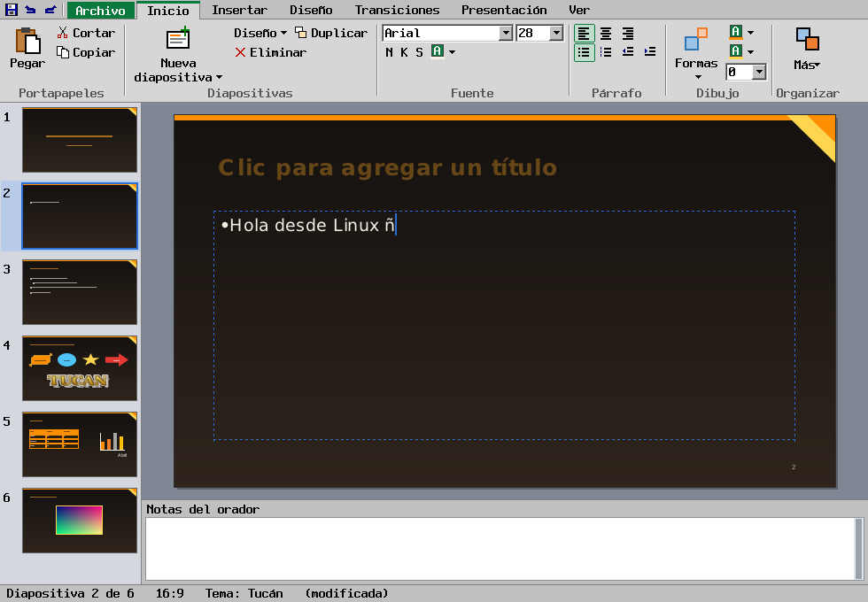

# Tucán portable

**Tucán** (presentaciones) de [SaguiOS-Extended](https://github.com/aleanun89/sagui-os-extended-es), compilado para Linux con SDL 2.

Las fuentes de la aplicación son **las mismas que en SaguiOS**: no hay una versión aparte. Lo que cambia es una capa
pequeña, `userland/portable/`, que hace en Linux lo que en SaguiOS hace el kernel (ventanas, eventos, archivos, reloj,
portapapeles) con la SDL 2. El resto, incluida la biblioteca gráfica de SaguiOS (la libsagui), se compila sin tocar.

## Compilar

    sudo apt install build-essential libsdl2-dev python3
    make -j4
    ./build/portable/tucan [archivo]

Hace falta un compilador de C (gcc o clang), `make`, Python 3 (genera la fuente de 8x16 de la interfaz) y los archivos
de desarrollo de SDL 2 (`sdl2-config`). También hay un `CMakeLists.txt` que llama al mismo Makefile.
Sin ventana (pruebas): `SDL_VIDEODRIVER=dummy`; con un guion de eventos, `SAGUI_ROTEIRO=guion.txt`
(ver `docs/portable.md`).

## Qué funciona y qué no

Funciona: la interfaz tal como en SaguiOS, ratón, teclado, menús, diálogos de abrir y guardar, portapapeles del sistema,
archivos del usuario (`/home` es tu carpeta personal): crear y editar presentaciones, guardar (formato propio y PPTX), exportar a PDF, PPTX y PNG, modo presentación, `--demo`, `--info` y `--convertir` por línea de órdenes.
No funciona fuera de SaguiOS: el asistente de IA (sin red); tampoco red, audio, información del sistema ni cuentas de usuario.
Solo Linux; Windows sin probar. Interfaz en español.

## Variables de entorno

`SAGUI_DATOS` (carpeta de datos con `fontes/`), `SAGUI_ESCALA` (1 a 4, amplía la ventana), `SAGUI_REGISTRO`, `SAGUI_ROTEIRO`.

## Licencia

GPL: las fuentes de la aplicación son GPL-2.0-or-later y la libsagui mezcla GPL-2.0-or-later y GPL-3.0-only, así que el
programa enlazado se distribuye bajo la **GPL v3** (`LICENSE`); el texto de la GPL v2 está en `LICENSES/GPL-2.0.txt` y cada
fichero declara la suya en `SPDX-License-Identifier`. Avisos de terceros en `AVISOS-TERCEROS.md`.

## Origen

Parte de [SaguiOS-Extended](https://github.com/aleanun89/sagui-os-extended-es); la fuente de verdad es ese repositorio. Este se regenera con `tools/portable_repos.py`.

Repositorios hermanos (mismas capa y libsagui): [Mico](https://github.com/aleanun89/mico), [Pluma](https://github.com/aleanun89/pluma), [Macaco](https://github.com/aleanun89/macaco), [Paint](https://github.com/aleanun89/paint), [PlanoMini](https://github.com/aleanun89/planomini), [GebraMini](https://github.com/aleanun89/gebramini).

---

## English

**Tucán** (presentations) from [SaguiOS-Extended](https://github.com/aleanun89/sagui-os-extended-es), built for Linux on SDL 2. The application sources are the
very same ones used in SaguiOS; a small layer (`userland/portable/`) replaces the kernel calls (windows, events, files,
clock, clipboard) with SDL 2, and the rest of SaguiOS' GUI library is compiled untouched.

    sudo apt install build-essential libsdl2-dev python3
    make -j4 && ./build/portable/tucan [file]

Not available outside SaguiOS: networking (no AI assistant), audio. Linux only (Windows untested).
Licence: GPL v3 as a combined work (see `LICENSE`); individual files are GPL-2.0-or-later or GPL-3.0-only (SPDX tags).
Third-party notices: `AVISOS-TERCEROS.md`. The interface is in Spanish. Sibling repositories: see the Spanish section above.

## Português (Brasil)

**Tucán** (apresentações) do [SaguiOS-Extended](https://github.com/aleanun89/sagui-os-extended-es), compilado para Linux com SDL 2. Os fontes do aplicativo
são os mesmos do SaguiOS; uma camada pequena (`userland/portable/`) substitui as chamadas ao kernel (janelas, eventos,
arquivos, relógio, área de transferência) pela SDL 2, e o resto da biblioteca gráfica do SaguiOS é compilado sem alterações.

    sudo apt install build-essential libsdl2-dev python3
    make -j4 && ./build/portable/tucan [arquivo]

Não funciona fora do SaguiOS: rede (sem assistente de IA), áudio. Só Linux (Windows não testado).
Licença: GPL v3 como obra combinada (veja `LICENSE`); cada arquivo é GPL-2.0-or-later ou GPL-3.0-only (tags SPDX).
Avisos de terceiros: `AVISOS-TERCEROS.md`. A interface está em espanhol.
